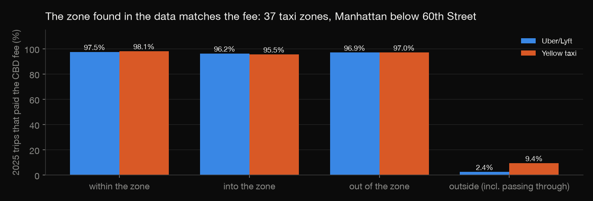
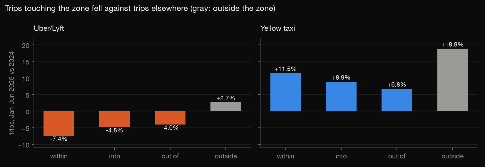
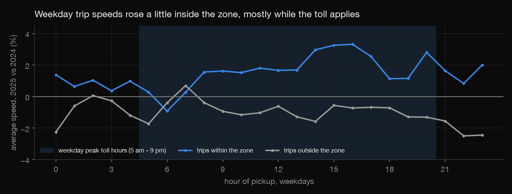
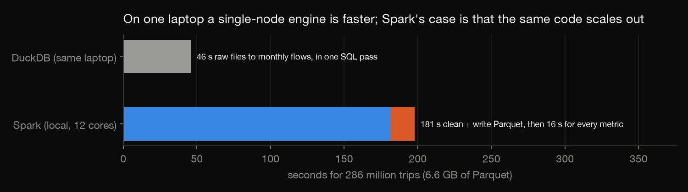

# NYC congestion pricing in Spark: 286 million trips before and after

New York started charging vehicles that enter Manhattan below 60th Street on 5 January 2025, and every taxi and
Uber/Lyft trip touching that zone now pays a CBD fee. This project uses Apache Spark to compare January–June 2025
with January–June 2024: 286,275,336 yellow-taxi and high-volume for-hire (Uber, Lyft) trips from the city's trip
records. It asks three questions:
- Did trips touching the zone fall?
- Did they get faster?
- Does the answer hold up when the whole pipeline is rebuilt in another engine?

Build log: https://mrrishit909.github.io/projects/taxi-spark/

## Data

NYC Taxi & Limousine Commission trip record data:
- yellow taxi and FHVHV monthly Parquet files, January–June of 2024 and 2025 (24 files, 6.6 GB);
- the taxi zone lookup.

`download.py` fetches them. They are not committed.

## Steps

| Step | File | What it does |
|---|---|---|
| 1 | `download.py` | the 24 monthly files |
| 2 | `curate.py` | Spark: two services' columns become one schema; trips that cannot be real are dropped and counted by the first rule broken; Parquet partitioned by service/year/month |
| 3-4 | `metrics.py` | Spark: find the congestion zone from the fee itself; class every trip as within, into, out of or outside; monthly trips, miles, hours and fares; weekday speed by hour |
| 5 | `check.py` | the whole pipeline again in DuckDB SQL, from the raw files |
| 6 | `charts.py` | charts |

Run: `python3 -m venv venv && ./venv/bin/pip install pyspark duckdb pandas pyarrow matplotlib` (Java 17+), then
`./venv/bin/python download.py && ./venv/bin/python curate.py && ./venv/bin/python metrics.py && ./venv/bin/python check.py && ./venv/bin/python charts.py`.

## Cleaning

272,950,020 trips are kept; 13,325,316 (4.7%) are dropped, each for the first rule it breaks
(`results/cleaning.csv`). The rules:
- pickup outside the file's month;
- zone unknown or outside NYC;
- no time or over 3 hours;
- no distance or over 100 miles;
- over 80 mph;
- negative fare.

Most Uber/Lyft drops are trips to or from outside the city. Yellow-taxi negative fares jumped from 289,313 in 2024 to
1,198,424 in 2025.

## Finding the zone in the data

A taxi zone counts as inside the congestion zone if at least 90% of its own 2025 trips (start and end in it, at least
1,000 of them) paid the CBD fee. That gives 37 zones, all in Manhattan below 60th Street (`results/cbd_zones.csv`).
The fee confirms the definition: 95.5–98.1% of trips within, into or out of those zones paid it. Of trips classed as
outside, 2.4% (Uber/Lyft) and 9.4% (yellow) paid it; these are mostly trips passing through.

## Results (January–June, 2025 vs 2024)

| Service | Flow | Trips | Average speed |
|---|---|---|---|
| Uber/Lyft | within the zone | −7.4% | +2.3% |
| Uber/Lyft | into / out of | −4.8% / −4.0% | +2.9% / +3.5% |
| Uber/Lyft | outside | +2.7% | −0.7% |
| Yellow taxi | within the zone | +11.5% | +2.3% |
| Yellow taxi | into / out of | +8.9% / +6.8% | −0.6% / +1.9% |
| Yellow taxi | outside | +18.9% | −2.5% |

Against trips elsewhere, trips touching the zone fell for both services: by 6.7 to 10.0 points for Uber/Lyft, and by
7.4 to 12.1 points for yellow taxis, whose trips grew everywhere. Trips within the zone got 3.1 (Uber/Lyft) and 4.8
(yellow) points faster relative to trips outside it. On weekdays the gain sits mostly in the toll hours.

**Speed here is trip speed:** miles ÷ minutes of the trip, including pick-up and drop-off. It is not measured traffic
speed. And before-and-after is not cause: fares, the economy and app pricing also moved between the two years.

## Spark, and an honest comparison

The Spark jobs run on one laptop (local mode, 12 cores, 8 GB driver):
- **Curation:** 181 s from raw files to curated Parquet.
- **Metrics:** 16 s for every metric. The 2025 query is pruned to the `year=2025` partitions, and the zone lookup is
  broadcast to every task (`results/plan_zone_query.txt`).

`check.py` rebuilds the same results in DuckDB in 46 s, and matches Spark on every cleaning count, every zone and
every monthly sum. On one machine a single-node engine is faster. Spark's case is that the same code runs unchanged on
a cluster when the data outgrows one machine.

## Not done

- Only taxi and app-based trips; private cars, buses and the subway are not in this data.
- No weather or event controls, and no synthetic control.
- Trips through the zone with neither end in it count as outside.
- Not run on a real cluster.
